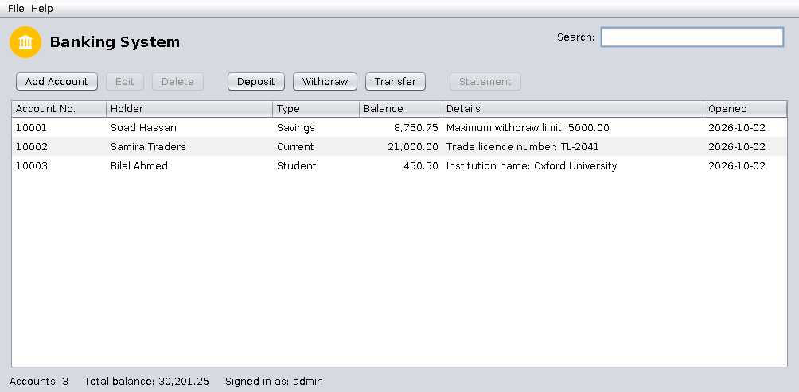

<div align="center">

# 🏦 Banking System

**A desktop banking application built with Java 21 and Swing**


[Features](#-features) · [Quick start](#-quick-start) · [Account rules](#-account-rules) · [Data & security](#-data--security) · [Project layout](#-project-layout)



<sub>The look and feel follows your operating system.</sub>

</div>

---

## ✨ Features

| Area | What you get |
|------|--------------|
| **Accounts** | Savings, Current and Student accounts - add, edit, delete |
| **Money** | Deposit, withdraw and **transfer between accounts** (atomic: both sides change or neither) |
| **Statements** | Balance enquiry and full transaction history per account (double-click a row) |
| **Search** | By account number, holder name, account type or details - results update as you type |
| **Overview** | Sortable table with account count and total balance |
| **Security** | Salted PBKDF2 password hashes, lock-out after 3 wrong attempts, change-password dialog |
| **Safety** | Saved after every operation, with a `.bak` copy of the previous version |

## 🚀 Quick start

**Requirement:** JDK 21 or newer (`java -version` / `javac -version`).

```bash
git clone https://github.com/matlum2005/Banking-System.git
cd Banking-System

./run.sh        # Linux / macOS  (builds dist/BankingSystem.jar on first run)
run.bat         # Windows
```

**First login:** user `admin`, password `admin`. The app asks you to change it right away
(**File → Change password…**).

<details>
<summary><b>Other ways to build and test</b></summary>

```bash
./build.sh                      # plain javac -> dist/BankingSystem.jar (build.bat on Windows)
java -jar dist/BankingSystem.jar

mvn test                        # run the unit tests (JUnit 5)
mvn package                     # -> target/BankingSystem.jar
```
</details>

## 📏 Account rules

| Type | Minimum balance | Extra field | Max. per withdrawal |
|------|----------------:|-------------|--------------------:|
| Savings | 2,000 | Withdraw limit | set per account |
| Current | 5,000 | Trade licence number | no limit |
| Student | 100 | Institution name | 20,000 |

- A withdrawal or transfer may bring the balance **down to** the minimum, never below it.
- Amounts accept at most 2 decimals and must be greater than zero.
- Money is stored as `BigDecimal`, so there are no floating-point rounding errors.

## 🔐 Data & security

Data lives in the `data/` folder where you start the program
(change it with `java -Dbank.data.dir=/some/folder -jar dist/BankingSystem.jar`):

| File | Content |
|------|---------|
| `bank.tsv` | Accounts and statements (plain text, tab separated) |
| `bank.tsv.bak` | The version before the last change |
| `users.properties` | Login hashes (never plain-text passwords) |

- If `bank.tsv` is damaged, the app **refuses to start** instead of silently starting empty and
  overwriting it. Restore it from `bank.tsv.bak`.
- Back up `data/` regularly. It is listed in `.gitignore` - **never commit it**.
- The old version's serialized files (`data`, `data.bin`) are no longer read; they only held test accounts.

## 🗂 Project layout

```text
src/main/java/com/bankingsystem/
├── App.java          entry point
├── model/            accounts and transactions (no GUI code)
├── service/          Bank (all rules), AuthService, AccountStore interface
├── storage/          FileAccountStore (text-file persistence)
├── exception/        BankException and subclasses
└── ui/               Swing screens
src/test/java/        JUnit 5 tests: rules, bank, storage, login
docs/                 original project report (PDF) and screenshot
```

See [CHANGELOG.md](CHANGELOG.md) for everything that was fixed and added in 2.0.0.

## 🤝 Contributing

1. Fork [matlum2005/Banking-System](https://github.com/matlum2005/Banking-System)
2. Create a branch: `git checkout -b feature/my-feature`
3. Make sure `mvn test` (or the tests in your IDE) passes
4. Commit, push, and open a pull request

## 👤 Author

**matlum2005** - [github.com/matlum2005](https://github.com/matlum2005)
